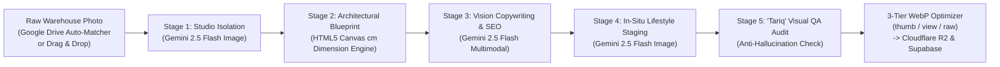

# B HOME — AI Product Studio & Multimodal Merchandising Portal (`web-studio`)

An internal **5-Stage Multimodal AI Product Photography, Architectural Blueprint, Copywriting & Merchandising Workstation** built for **B HOME (Bachir Home)** to eliminate manual photo-editing, dimension drawing, and copywriting bottlenecks across **2,160+ houseware & kitchenware SKUs**.

---

## 🎯 Business Problem Solved

Preparing thousands of physical wholesale & DTC e-commerce SKUs traditionally requires:
1. Studio photography & manual background removal.
2. Measuring items and manually drawing dimension arrows in Photoshop/Illustrator.
3. Writing bilingual titles, luxury descriptions, craftsmanship bullets, and SEO tags.
4. Staging products in realistic room settings.
5. Auditing catalog completeness across thousands of items.

**`web-studio`** automates this entire workflow inside a single React + TypeScript + **Google Gemini 2.5 Multimodal** workstation—reducing per-SKU onboarding time by **~90%**.

---

## 🏗️ System Architecture & 5-Stage AI Pipeline



---

## ✨ Key Features & Modules

1. **Web Inventory Media Hub (`MediaGridView`)**:
   - Real-time media health badges (`🟢 Complete`, `🟡 1 Angle`, `🔴 Missing`) across 2,160+ SKUs.
   - Multi-angle hover scrubbing (`hero1`, `dim1`, `angle1`..`angle5`) and batch drag-and-drop upload.
2. **5-Stage Gemini 2.5 AI Studio (`AiStudioView`)**:
   - **Studio Backdrop Isolation & Tunable Lighting (3500K–6500K)** via `gemini-2.5-flash-image`.
   - **Automated Architectural Dimension Blueprints** (`dimensionBlueprintEngine.ts`) rendering exact $L \times W \times H\text{ (cm)}$ callouts onto product imagery.
   - **Multimodal Vision Copywriting** (`gemini-2.5-flash`) generating titles, taglines, craftsmanship bullets, room placement recommendations, and SEO tags.
   - **Automated Visual Fidelity & Anti-Hallucination Audit (*Tariq*)** comparing raw input geometry against AI-staged output, complete with an interactive **Before/After Curtain Slider**.
3. **Split Studio Workstation & Live Device Simulators**:
   - Multi-select taxonomy pill pickers (Tags, House Rooms, Materials), live **iPhone/Android Storefront Preview**, and automated **1024×1024 WhatsApp Marketing Card Generator** (`collageGenerator.ts`).
4. **Google Drive Regex SKU Auto-Matcher (`skuMatcher.ts`)**:
   - Automatically maps batch filenames (e.g., `64514_1.webp`) directly to catalog SKU `#64514`.
5. **Mass Audit Matrix & Promotional Banner Studio**:
   - Spreadsheet-grade bulk auditing for missing photos/dimensions/categories + visual campaign banner publisher synced to **Supabase** and **Cloudflare R2 CDN**.

---

## 🛠️ Tech Stack

* **Frontend**: React 18, TypeScript 5, Vite 5, Tailwind CSS, TanStack React Query v5, Lucide React
* **AI & Multimodal Vision**: Google Gemini API (`gemini-2.5-flash`, `gemini-2.5-flash-image`)
* **Media & Graphics Processing**: HTML5 Canvas 2D Blueprint Engine, Client-Side 3-Tier WebP Compression Engine (`thumb`, `view`, `raw`)
* **Cloud & Storage**: Supabase (PostgreSQL, PostgREST, Storage), Cloudflare R2 Edge CDN, Local Node.js/MSSQL Media Bridge (`:8090`)

---

## 🚀 Local Setup

1. Install dependencies:
   ```bash
   npm install
   ```
2. Configure `.env.local`:
   ```env
   VITE_SUPABASE_URL=https://your-project.supabase.co
   VITE_SUPABASE_ANON_KEY=your-anon-key
   ```
3. Start the development server:
   ```bash
   npm run dev
   ```
